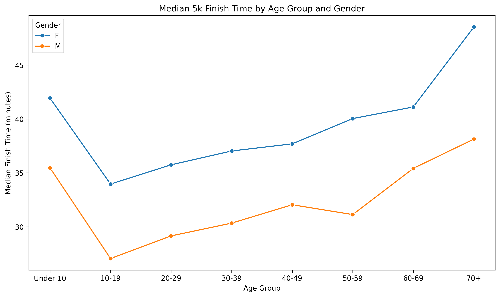
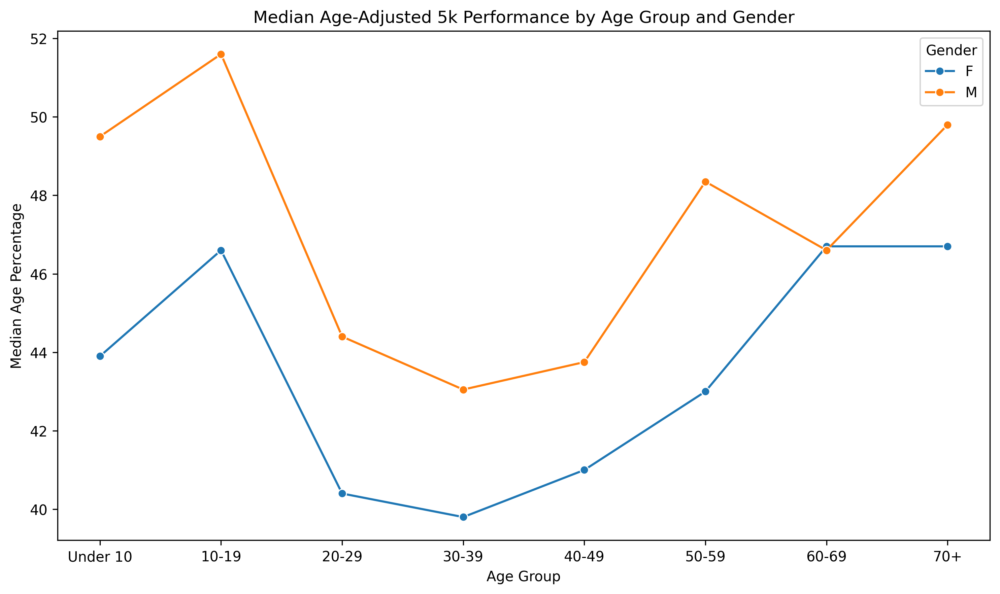

# 5k Performance Analysis

An end-to-end data analysis project examining how age and gender are associated with 5k performance, and how those patterns change when performance is measured using raw finish time versus age- and gender-adjusted performance. 

The project uses the RunSignup API to collect race results, processes and validates the data in Python, stores the resulting datasets in a relational SQLite database, queries the data with SQL, and uses statistical modeling and visualization to investigate performance patterns across 5k runners.

## Research Question

**How are age and gender associated with 5k performance, and how do these patterns differ when performance is measured using raw finish time versus age- and gender-adjusted performance?**

## Project Overview

The final dataset contains **5,073 performance records from 30 editions of six community 5k races** hosted through RunSignup.

The project was designed as an end-to-end analytical pipeline:

1. Collect race and participant result data through the RunSignup API.
2. Clean and validate race results in Python.
3. Organize race, event, and result data into a relational SQLite database.
4. Query and summarize the data using SQL.
5. Explore age and gender performance patterns in Python.
6. Compare absolute finish time with age-graded performance.
7. Model raw finish time using age, gender, and race-event context.

## Tech Stack 

- **Python:** pandas, requests, python-dotenv
- **SQL:** SQLite
- **Visualization**: Matplotlib, Seaborn
- **Statistical Analysis:** statsmodels
- **Data Source:** RunSignup API
- **Development:** Jupyter Notebook, VSCode, Git/GitHub

## Key Findings 

Raw and age-adjusted performance produced meaningfully different patterns. 

- Raw finish times showed a nonlinear relationship with age, with teenagers recording the fastest median times in the age group analysis. 
- Male performances had lower median raw finish times within each age group in this sample.
- Age grading changed the relative performance of several age groups. Older runners ranked higher when performance was evaluated relative to age- and gender-specific benchmarks rather than absolute speed.
- After controlling for age and race event, male performances were associated with ~5.5 minute lower raw finish times.
- Adding race-event fixed effects increased model R^2 from approximately 0.130 to 0.237, indicating that event context accounts for meaningful variation in observed finish times.

## Raw Finish Time


## Age-Adjusted Performance


Raw finish time measures absolute speed, while age grading compares performance with age- and gender-specific benchmarks. The contrast between these metrics shows why conclusions about runner performance depend on how performance is defined. 

## What Is Age Grading?

RunSignup reports an **Age Percentage**, also referred to as age grading. Age grading compares a runner's finish time with an age- and gender-specific standard for the same distance. Higher percentages represent stronger performance relative to the applicable benchmark, with values approaching 100% representing performance approaching the relevant world-best standard.

In this project, age percentage is treated as an alternative standardized performance metric rather than as a replacement for raw finish time. Raw time measures absolute speed, while age grading provides context for performance relative to age- and gender-specific standards. 

## Pipeline Architecture

```text
RunSignup API
      │
      ▼
Data Collection
src/collect_data.py
      │
      ▼
Data Cleaning
src/clean_data.py
      │
      ▼
Dataset Construction
src/build_dataset.py
      │
      ▼
SQLite Database
src/build_database.py
      │
      ▼
data/processed/5k_performance.db
      │
      ├──────────────► SQL Analysis
      │                sql/analysis_queries.sql
      │
      ▼
Statistical Analysis & Visualization
notebooks/5k_analysis.ipynb
      │
      ▼
figures/
```

## Repository Structure

```text
5k-performance-analysis/
├── README.md
├── requirements.txt
├── run_pipeline.py
├── figures/
│   ├── median_finish_time_by_age_gender.png
│   └── median_age_adjusted_by_age_gender.png
├── notebooks/
│   └── 5k_analysis.ipynb
├── sql/
│   └── analysis_queries.sql
└── src/
    ├── collect_data.py
    ├── clean_data.py
    ├── build_dataset.py
    └── build_database.py
```

## Methodology
### Data Collection

Race metadata and participant results were collected from the RunSignup API. The collection pipeline identifies completed 5k running events for a selected set of community races and retrieves all available result pages for each event. Pagination is handled explicitly so that the analysis includes the full set of available results rather than just the first page returned by the API.

### Data Cleaning
The cleaning pipeline involves:
- converting chip times into numeric seconds for analysis
- converting age percentages into numeric values
- preserving missing finish times rather than reconstructing them from rounded pace values
- treating identified placeholder ages as missing while retaining otherwise usable performance records
- retaining a non-name result identifier while excluding individuals' names, bib numbers, and location fields from the analytical dataset

Missing observations are kept where possible and excluded only from analyses requiring the missing variable.

### Relational Database

Cleaned data are organized into three related SQLite tables:
- `races`: race metadata
- `events`: individual race editions and dates
- `results`: participant performance records

The database uses primary and foreign keys to represent the relationship between races, events, and individual results. Analytical SQL queries join these tables to examine participation and performance across races and demographic groups.

### Statistical Analysis

Exploratory analysis examines the distributions of age and raw finish time followed by descriptive comparisons across age groups and gender. Raw finish time is modeled using OLS regression. The modeling progresses from a linear age specification to a quadratic age relationship and finally adds race-event fixed effects to account for systematic differences in average finish times across event editions.

Because participants within the same event share conditions such as course, date, and race environment, cluster-robust standard errors are calculated at the event level, which adjust statistical uncertainty for potential within-event dependence while the event fixed effects separately account for differences in average finish times across events. 

All regression results are interpreted as associations rather than causal effects.

## Running the Project
### 1. Clone the repository
Clone the repository and navigate to the project directory.

### 2. Install dependencies.
```bash
pip install -r requirements.txt
```

### 3. Configure RunSignup API Credentials
Create a `.env` file in the project root containing your RunSignup API credentials:

```text
rsu_api_reg=your_api_key
X-RSU-API-REG-SECRET=your_api_secret
```
### 4. Build the Dataset and Database
From the project root, run:

```bash
python run_pipeline.py
```

The pipeline collects data from the RunSignup API, cleans and validates the results, and builds the SQLite database at:

```text
data/processed/5k_performance.db
```

### 5. Run the Analysis

Open: 

```text
notebooks/5k_analysis.ipynb
```

and run the notebook from top to bottom.

The notebook queries the generated SQLite database and performs the exploratory analysis, visualization, and statistical modeling.

## Limitations

- The dataset contains selected RunSignup community races rather than a random or representative sample of all 5k runners.
- Race coverage is uneven across events and years, and a majority of records come from the largest races in the dataset.
- Although the data span multiple race editions, they do not constitute a longitudinal study of individual runners.
- Event fixed effects account for systematic differences between race editions but do not directly measure factors such as weather, elevation, course difficulty, training history, fitness, or injury.
- Cluster-robust inference is based on 30 event clusters, so statistical uncertainty should be interpreted cautiously.
- Age grading is a benchmark-based standardized performance measure and should not be interpreted as a complete measure of running ability.
- Because the analysis is observational, reported relationships should not be interpreted as causal effects.

## Conclusion

Absolute and age-adjusted measures tell different but complementary stories about 5k performance. Raw finish time captures absolute speed, while age grading places performance in the context of age- and gender-specific benchmarks.

Across the collected races, age showed a nonlinear relationship with raw finish time, gender differences were visible in absolute performance, and event context accounted for meaningful additional variation. Age adjustment changed several of the descriptive patterns observed using raw time alone, particularly for older runners.

Rather than identifying a single "best" measure of performance, this analysis shows how the choice of performance metric and analytical context can change the interpretation of the same race results.

## Data Source & References

Race and participant result data for this project were collected through the RunSignup API. RunSignup provides access to race information, events, participants, and race results. The age-adjusted performance measure used in this analysis is RunSignup's reported Age Percentage, or age grade. RunSignup calculates age-graded results using age-graded standards and factors approved through World Masters Athletics (WMA) and USA Track & Field (USATF).

### References
- [RunSignup API Documentation](https://runsignup.com/API)
- [RunSignup API Overview](https://runsignup.com/API/DocOverview)
- [RunSignup: Age Grade Tables Updated](https://runsignup.blog/2015/01/28/age-grade-tables-updated/)
